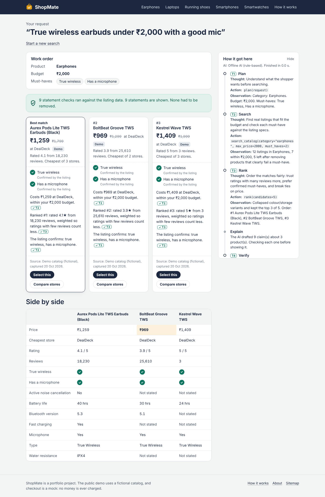
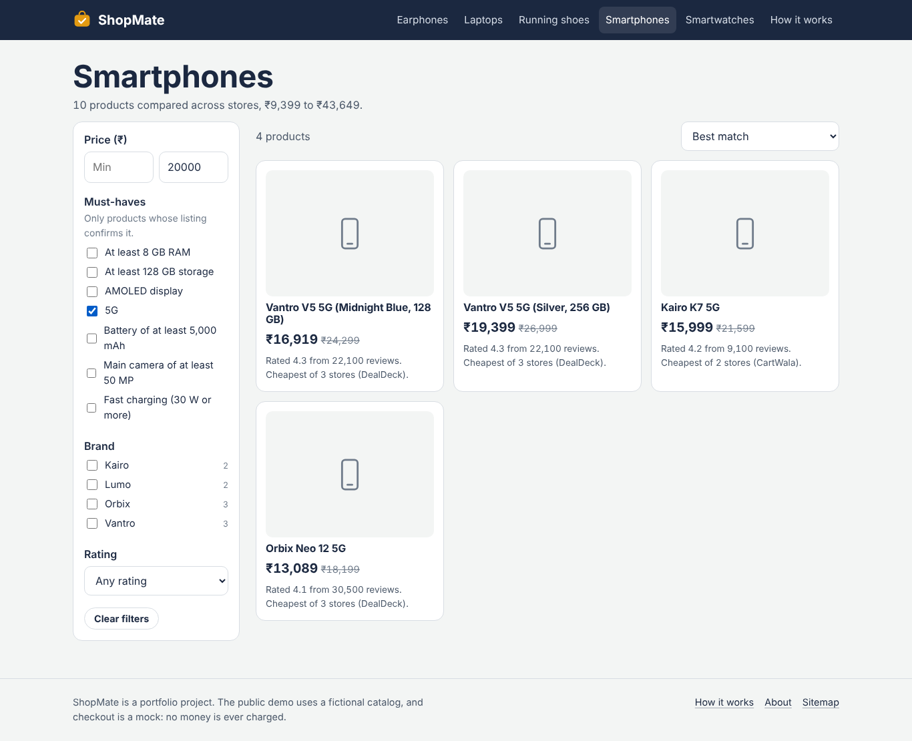
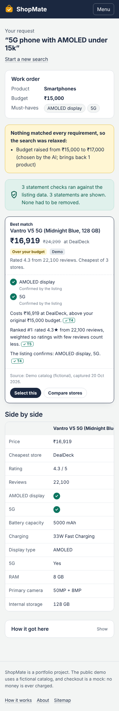

# ShopMate

A product comparison service for Indian shoppers. Describe what you want in plain English ("true wireless earbuds under ₹2,000 with a good mic"), and ShopMate compares stores, picks the 3 best products, and **checks every statement against the listing data before you see it**.

Built with **PHP 8 / Laravel 13, MySQL, HTML/CSS and jQuery**, and **live on AWS EC2**: [shopmate.13-233-126-36.sslip.io](http://shopmate.13-233-126-36.sslip.io)



| Browse with filters | Product page with store prices and history | Mobile, after the search was relaxed |
|---|---|---|
|  |  |  |

### Quick tour of the code

| Where | What it shows |
|---|---|
| [`app/Services/Pipeline/Steps`](app/Services/Pipeline/Steps) | Each step of a search is its own class (Planner, Searcher, Ranker, Explainer, Verifier...) behind one `PipelineStep` interface |
| [`Verifier.php`, line 117](app/Services/Pipeline/Steps/Verifier.php#L117) | How code checks the AI: any number in an AI sentence that isn't a checked fact is rejected |
| [Partner API](#partner-api-security) | How retailers update their prices securely |
| [Deployment log](#deployment-log) | A real problem from the live AWS server, its cause, and how I fixed it |

---

## Background

ShopMate started as a three-person agentic AI project at university, built in Python, where I built the frontend. I rebuilt the whole system on my own in **PHP / Laravel and MySQL** to learn that stack properly, and deployed it on **AWS EC2**.

The main idea: **the AI can explain, but code checks every fact.**

---

## How a search works

The AI makes decisions in a few steps; plain PHP does everything that must be exact. Each step is its own class behind one `PipelineStep` interface, so one step can be changed or tested without breaking the others.

```
Plan (AI) → Search (code) → Rank (code) → Explain (AI) → Verify (code)
```

| Step | Who | What happens |
|---|---|---|
| Plan | AI | Reads the sentence and makes a plan: category, budget and must-haves. A budget written in the text is read directly by code, so the AI can't get it wrong |
| Search | code | Searches MySQL and removes anything over budget, or anything that clearly doesn't have a must-have |
| Rank | code | Ranks mostly by rating, trusting ratings with many reviews more |
| Explain | AI | Writes a short reason for each of the top 3 picks |
| Verify | code | Checks every sentence against the database. A wrong sentence gets one rewrite; if it's still wrong, it's deleted |

**Fast searches.** Each product's best price is stored in advance, and there is an index on category and price, so MySQL only reads the rows it needs. All the products and their prices load in three queries, not hundreds.

**Honest gaps.** If two labels give different values for the same spec, no value is stored. The shopper sees a **?** "couldn't confirm". Missing or conflicting information is never shown as a yes.

---

## Partner API (security)

Retailers can push their own prices to ShopMate, the way booking sites push reservations to a channel manager. Because many partners share one system, each partner is checked separately and can be switched off on its own without stopping the others.

Every partner request passes these checks in order. The first failure stops it:

| # | Check | What it stops |
|---|---|---|
| 1 | API key | Unknown or missing partner key |
| 2 | IP allowlist | Requests from outside the partner's registered IP addresses |
| 3 | Signature | Requests that were changed on the way (HMAC signature), old requests, and copied requests sent again (each request can be used only once) |
| 4 | Kill switch | Suspended partners are refused; read-only partners can read but not change prices |
| 5 | Rate limit | Too many requests from one partner |

- **A partner can only change its own store's prices**, never another store's.
- **The IP can't be faked.** The app used to trust the `X-Forwarded-For` header from anyone, which would have let an attacker claim an allowed IP. Now it is only trusted from known proxies, and a test checks that this stays fixed.

---

## Deployment log

A real problem from running this in production, and what I did about it.

| Problem | Cause | Fix |
|---|---|---|
| Every search returned **"Server Error"** on the live site, but worked on my laptop | The Laravel log showed `Data too long for column 'llm_driver'`. My laptop used SQLite, which ignores column lengths; MySQL on the server rejected the value | A new migration widening the column. Lesson: keep the development setup close to production |

---

## What I would improve next

- HTTPS and background processing on the live server.
- A second real store, so real shoppers can use it.
