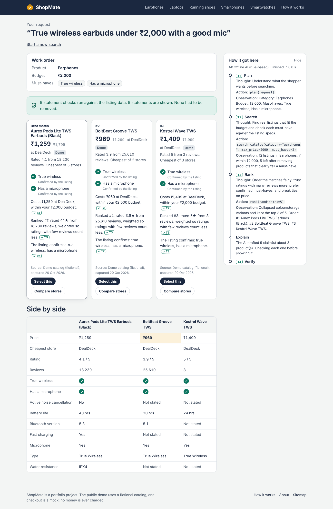
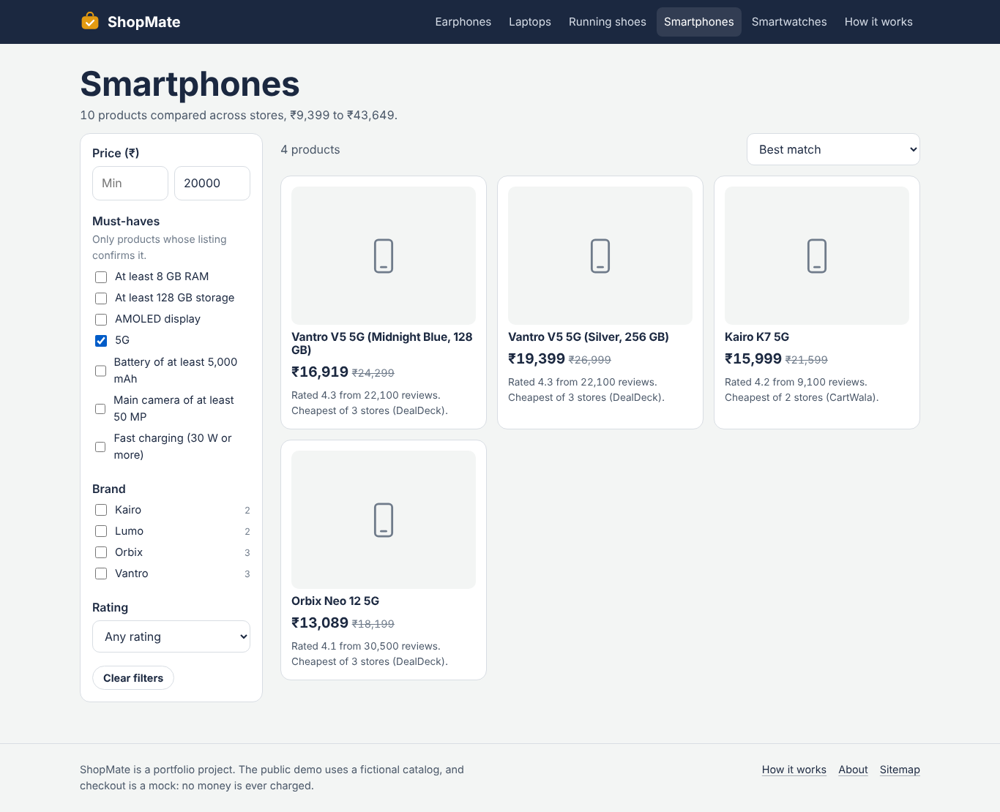
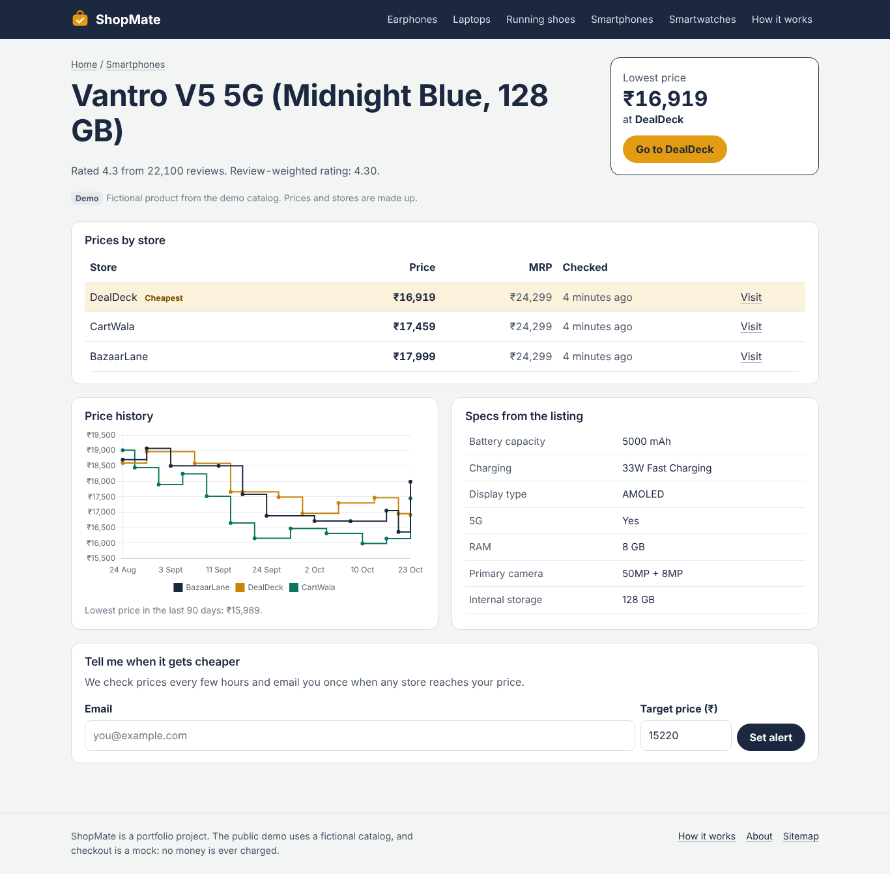
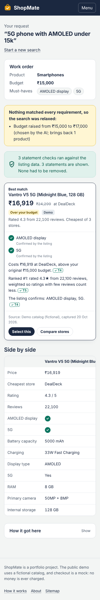

# ShopMate

A product comparison service for Indian shoppers. Describe what you want in plain English ("true wireless earbuds under ₹2,000 with a good mic"), and ShopMate compares stores, picks the 3 best products, and **checks every statement against the listing data before you see it**. Nothing is bought without your explicit approval.

Built with **PHP 8 / Laravel 13, MySQL, HTML/CSS and jQuery**, and **live on AWS EC2**: [shopmate.&lt;ip&gt;.sslip.io](http://shopmate.13-233-126-36.sslip.io)



| Browse with filters | Product page with store prices and history | Mobile, after the search was relaxed |
|---|---|---|
|  |  |  |

---

## Background

ShopMate started as our **agentic AI team project at university**, built in Python. I rebuilt it on my own in **PHP / Laravel and MySQL** to learn that stack properly, and used the rebuild to harden it:

- **The AI never touches facts.** Prices, filtering and ranking are plain PHP, and every sentence the AI writes is checked against the product data before anyone sees it.
- **Every partner request is verified.** A partner API lets retailers push their own prices, with IP allowlisting, HMAC-signed requests, replay protection and a per-partner kill switch.
- **It runs in production.** It's deployed on AWS EC2, and the [deployment log](#deployment-log) lists the real problems I hit there and how I fixed them.

---

## What it does

**For shoppers**
- **AI search**: type a request; get a *work order* (how it was understood), 3 ranked picks, a side-by-side comparison table, and a step-by-step trace of how the answer was reached.
- **Checked statements**: every sentence on a card carries a small tag like `T2`. Click it to jump to the trace step its facts came from.
- **Honest gaps**: if a listing doesn't state something, it shows as **?** "couldn't confirm", never as a yes.
- **One clarifying question** when the request names no product type ("something for my dad's birthday"), never two.
- **Relaxed search** when nothing fits: the yellow note says exactly what was given up (e.g. "budget raised from ₹15,000 to ₹17,000").
- **Browse** each category with price, brand, rating and must-have filters (no page reloads; the URL keeps the filters so it can be shared).
- **Product page**: prices at every store (cheapest highlighted), 90-day price history chart, specs, and **price-drop email alerts**.
- **Mock checkout (Cart Mandate)**: tick consent, the server signs the exact cart, checkout is refused if anything changes.

**For the site owner**
- **SEO admin** (`/admin/seo`): edit title, description and keywords of any product, category or page, with a live Google-style preview.
- **Operations view** (`/admin/ops`): searches in the last 7 days, failures, average speed, claims removed, audit log, failed background jobs.
- **Partners** (`/admin/partners`): every partner's allowed IPs, recent activity and rejections, and Active / Read-only / Suspended buttons (the kill switch).
- **Health check** (`/health`) for uptime monitoring, plus a sitemap and robots.txt.

---

## Stack at a glance

| Skill | Where it is in this project |
|---|---|
| PHP, OOP | Pipeline steps are separate classes behind one `PipelineStep` interface; the AI sits behind an `LlmClient` interface with three implementations (Groq, offline, test) |
| Laravel | Eloquent models and relationships (incl. polymorphic SEO), queues, scheduler, validation, rate limiting, mail, Artisan commands |
| SQL / MySQL | Normalised schema with indexes, `EXISTS` sub-queries for spec filters, transactions with row locking, aggregate reports, `db:explain-browse` command |
| HTML, CSS, JavaScript, jQuery | Hand-written responsive CSS (no framework); jQuery for live search progress, filters, comparison table, modal, chart |
| System integration with booking/metasearch sites | Three data sources behind one `CatalogSource` interface (demo, private Flipkart export, DummyJSON API), Groq API, Frankfurter currency API |
| Optimising processing | Denormalised best price, composite indexes, eager loading, caching, background jobs (details below) |
| Improving UI / rebuilding PC and smartphone sites | Every page is designed for phone and desktop widths |
| Security for partner integrations | Partner API with per-partner IP allowlists, HMAC-signed requests, replay protection, a per-partner kill switch, rate limits and an audit log (details below) |
| AWS, infrastructure, maintenance | Live on EC2 (Ubuntu, Nginx, PHP-FPM, MySQL), production bugs found and fixed from the logs, security patch verification (see [deployment log](#deployment-log)); health check, cleanup jobs, and CI/CD and S3 backup scripts included |

---

## How a search works

The agent is a **fixed flowchart**, not a free-roaming agent. The AI makes decisions inside three steps; plain PHP does everything that must be exact.

```
Planner (AI) → Clarify → Search (code) ⇄ Replan (AI picks, code checks; max 2) → Rank (code) → Explain (AI) → Verify (code) → Respond
```

| Step | Who | What happens | File |
|---|---|---|---|
| Plan | AI | Sentence → category, budget, must-haves. A budget written in the text ("20k", "1.5 lakh") is read by code and wins over the AI | `app/Services/Pipeline/Steps/Planner.php` |
| Clarify | code | No product type → ask one question. Never asks twice | `Steps/Clarifier.php` |
| Search | code | Removes anything over budget; checks each must-have against typed spec facts: **met** (kept, ✓), **not met** (removed), **unknown / conflict / unsupported** (kept, ?) | `Steps/Searcher.php` |
| Replan | AI + code | Nothing fits → code lists every single change that brings products back (raise budget up to 50%, or drop one must-have) with how many products each unlocks. AI picks; an invalid pick falls back to a fixed rule | `Steps/Replanner.php` |
| Rank | code | Review-weighted rating (Bayesian average), plus share of must-haves confirmed, price as tie-breaker. Colour/storage variants collapsed | `Steps/Ranker.php` |
| Explain | AI | Writes short claims; each must cite a trace step and list its facts | `Steps/Explainer.php` |
| Verify | code | Checks every fact (price, rating, reviews, rank, specs, must-haves, "within budget" against the **original** budget) and rejects any number in the text that isn't a checked fact. One rewrite; anything still wrong is deleted | `Steps/Verifier.php` |

The search runs as a **background job** (queue), and the page polls for new trace steps every second, so progress appears live.

**No API key needed.** With `GROQ_API_KEY` empty, a rule-based **offline AI** (`app/Services/Llm/OfflineLlm.php`) answers the same tasks. It is also the automatic fallback if Groq is down, and the trace says so when that happens.

### Key design decisions

- **AI never handles facts.** Prices, filtering, ranking and checking are code, so a wrong AI answer can't produce a wrong price on screen.
- **Typed spec facts.** "RAM: 8 GB" is stored as the number 8, so "at least 8 GB" is a numeric comparison, not text matching. If a listing contradicts itself, no value is stored (`is_conflict`), never a guess.
- **Config, not code, for categories.** All categories, spec label aliases and supported must-haves live in `config/shopmate_specs.php`. Adding a category needs no PHP changes.
- **Cart Mandate.** The browser only sends an offer ID; the server looks up the price, signs the exact cart with HMAC-SHA256, and on checkout re-checks signature, cart contents, current price, 15-minute expiry and single use, inside a transaction with a row lock. Every step goes to `audit_logs`.

---

## Run it locally (Windows)

**You need:** PHP 8.3+, Composer and MySQL. The easiest way on Windows is [Laragon](https://laragon.org/) (includes all three). Git Bash works for every command below.

```bash
# 1. Get the code and install packages
cd shopmate
composer install            # creates composer.lock: commit it

# 2. Configure
cp .env.example .env
php artisan key:generate
```

3. Create an empty MySQL database called `shopmate` (Laragon: right-click → MySQL → Create database). Check `DB_USERNAME` / `DB_PASSWORD` in `.env` (Laragon's default is `root` with no password). Set `ADMIN_PASSWORD` if you want the admin pages.

```bash
# 4. Create tables and load the fictional demo catalog (48 products, 3 stores, 60 days of price history)
php artisan migrate --seed

# 5. Run the site, the background worker and the scheduler (three terminals)
php artisan serve
php artisan queue:work
php artisan schedule:work
```

Open http://localhost:8000. If you have Node installed, `composer dev` starts all three in one terminal.

> Don't want to run a worker? Set `QUEUE_CONNECTION=sync` in `.env`; searches then run inside the request (the page just waits until the search is finished).

**Use Groq instead of the offline AI:** put your key in `GROQ_API_KEY` and restart `queue:work`.

### Your private Flipkart data

Put one JSON file per category in `storage/app/private/flipkart/` (this folder is git-ignored, so it never reaches GitHub):

```
storage/app/private/flipkart/earphones.json
storage/app/private/flipkart/smartphones.json
storage/app/private/flipkart/laptops.json
storage/app/private/flipkart/smartwatches.json
storage/app/private/flipkart/running-shoes.json
```

```bash
php artisan products:import --source=local --captured-on=2026-10-08
```

Field names are read from common scraper names (`title`/`name`, `price`/`selling_price`, `specifications`, ...). If your export uses others, add them to the `FIELDS` list in `app/Services/Catalog/Sources/LocalJsonSource.php`. If spec labels don't map, add aliases in `config/shopmate_specs.php`.

**Keep Flipkart data off the public demo.** Their terms don't allow republishing it. Use it for local demos only; the public site uses the demo catalog.

Other sources: `--source=demo` (fictional, safe to publish) and `--source=dummyjson` (public demo API; USD prices converted to rupees with Frankfurter and labelled "approx.").

### Tests

```bash
php artisan test
```

61 tests, no internet or API key needed (the AI is replaced by the offline or a scripted test AI). They cover the budget parser, spec cleaning, ranking, the full pipeline, clarification, replanning (including an invalid AI pick), the verifier rejecting wrong prices, invented numbers, made-up citations and made-up products, every cart refusal case, browse filters, price alerts, SEO admin, the DummyJSON + Frankfurter import, and every partner API rejection (unknown key, wrong IP, faked `X-Forwarded-For`, bad signature, old timestamp, replayed request, read-only, suspended, rate limit, lockout, another store's product).

---

## Automation

| What | When | Command |
|---|---|---|
| Refresh prices, record history only when a price changes | every 6 hours | `prices:refresh` |
| Email shoppers whose target price was reached (once each) | hourly | `alerts:check` |
| Expire old cart approvals, delete searches older than 30 days | daily 03:15 | `shopmate:cleanup` |
| Remove failed jobs older than a week | daily | `queue:prune-failed` |
| Run searches in the background, retry if the worker crashes | on demand | queue job `RunSearchPipeline` |
| Retry Groq on rate limits/server errors, then fall back to offline AI | per AI call | `GroqClient`, `ResilientLlm` |
| Test, check code style, deploy, then check `/health` | every push to `main` | `.github/workflows/` |
| Database backup to S3, keep 7 days | nightly 02:30 | `scripts/backup.sh` |

All schedules are in `routes/console.php`; one cron line runs them (`deploy/crontab.txt`).

---

## Partner API (security)

Retailers can push their own prices to ShopMate, the way booking sites push reservations to a channel manager. Because many partners share one system, each partner is checked separately and can be switched off on its own without stopping the others.

Every request to `/api/partner/v1/*` passes these checks in order (`config/shopmate.php` → `partners.checks`). The first failure stops it:

| # | Check (class) | What it stops |
|---|---|---|
| 0 | Failed-attempt lockout (`PartnerGuard`) | An IP that fails authentication 10 times in a minute is refused, so keys and signatures can't be guessed at speed. Successful requests never count. |
| 1 | `ApiKeyCheck` | Unknown or missing `X-Partner-Key` |
| 2 | `IpAllowlistCheck` | Requests from outside the partner's registered IPs or CIDR ranges. An empty list blocks everything (fails closed). Runs before the signature check, so a leaked key and secret are useless from anywhere else. |
| 3 | `SignatureCheck` | Missing or wrong HMAC-SHA256 signature, timestamps more than 5 minutes off, and replayed requests (each nonce works once, stored with an atomic `Cache::add`) |
| 4 | `PartnerStatusCheck` | The kill switch: `suspended` partners are refused, `read_only` partners can read but not change prices |
| 5 | `RateLimitCheck` | Each partner's own requests-per-minute limit |

Each check is a small class behind one `PartnerCheck` interface, so adding a rule means writing one class and adding it to the list.

- **Generic errors outside, exact reasons inside.** Callers who haven't proven who they are only get `401 unauthorized` and a request ID. The exact reason (`ip_not_allowed`, `bad_signature`, `replayed_nonce`, …) goes to the audit log and the admin **Partners** page.
- **A partner can only touch its own store.** Updates for products the store doesn't sell are skipped, never applied (object-level authorization). Updates run in a transaction with row locks and record price history.
- **The IP can't be faked.** `X-Forwarded-For` is only believed when it comes from a proxy listed in `TRUSTED_PROXIES` (`config/trustedproxy.php`). It used to trust every proxy (`'*'`), which would have let anyone claim an allowlisted IP with one header. A test checks that this stays fixed.
- **Secrets are stored encrypted** (with `APP_KEY`), not hashed, because checking an HMAC needs the original secret. They are shown once at creation and can be rotated.

**Signing a request.** Sign these five lines, joined with `\n`, using HMAC-SHA256 with the partner secret (hex output):

```
PUT
/api/partner/v1/offers
1761300000                      (X-Partner-Timestamp, Unix seconds)
3f9c0d2a7b1e4c58a6d0e9f1b2c3d4e5 (X-Partner-Nonce, random, 16-64 chars)
<sha256 hex of the raw body>
```

Send the result as `X-Partner-Signature`, together with `X-Partner-Key`, `X-Partner-Timestamp` and `X-Partner-Nonce`. `scripts/partner-request.sh` does this with `openssl` and `curl`.

**Managing partners**

```bash
php artisan partner:create "CartWala feed" cartwala --ip=203.0.113.10 --ip=198.51.100.0/24 --rate=60
php artisan partner:ips pk_... --add=203.0.113.0/24 --remove=203.0.113.10
php artisan partner:status pk_... suspended          # or read_only / active (also buttons on /admin/partners)
php artisan partner:rotate-secret pk_...

PARTNER_KEY=pk_... PARTNER_SECRET=sk_... scripts/partner-request.sh GET http://127.0.0.1/api/partner/v1/offers
PARTNER_KEY=pk_... PARTNER_SECRET=sk_... scripts/partner-request.sh PUT http://127.0.0.1/api/partner/v1/offers \
  '{"offers":[{"product":"aurex-pods-lite-tws-earbuds-black","price":1199,"in_stock":true}]}'
```

`tests/Feature/PartnerApiTest.php` covers each rejection reason, the lockout, the kill switch and the cross-store rule.

---

## Live deployment (AWS EC2)

| Part | What's running |
|---|---|
| Server | One **EC2** instance (t3.small), Ubuntu 26.04 |
| Web | **Nginx** → **PHP-FPM 8.5** (Unix socket), `root` set to `public/` so nothing else is reachable |
| Database | **MySQL 8.4** on the same instance, with a separate app user that only has access to the `shopmate` database |
| Firewall | Security group: SSH and HTTP only |
| App settings | `APP_ENV=production`, `APP_DEBUG=false`, config/route/view caches built, `DEMO_SIMULATE_PRICES=true` (fictional catalog only) |
| Address | `shopmate.<ip-with-dashes>.sslip.io`, a free hostname that points at the server's IP |

Updating the live site:

```bash
cd /var/www/shopmate
git pull
php artisan migrate --force
php artisan optimize:clear
php artisan config:cache && php artisan route:cache && php artisan view:cache
sudo chown -R ubuntu:www-data storage bootstrap/cache
```

**Not set up on the live server yet** (scripts and config are in the repo): HTTPS with certbot, the queue worker and cron scheduler (the live site runs searches inside the request with `QUEUE_CONNECTION=sync`), nightly S3 backups (`scripts/backup.sh`) and automatic deploys from GitHub Actions (`.github/workflows/`, `scripts/deploy.sh`).

### Deployment log

Real problems from running this in production, and what I did about them.

| Problem | Cause | Fix |
|---|---|---|
| Every search returned **"Server Error"** on the live site, but worked locally | The Laravel log showed `SQLSTATE[22001]: Data too long for column 'llm_driver'`. The name "Offline AI (rule-based)" is 23 characters and the column was 20. SQLite (used locally) ignores string lengths; MySQL rejects the value. | New migration widening the column. Lesson: test against the same database engine you run in production. |
| The partner IP allowlist could have been bypassed | The app trusted `X-Forwarded-For` from **any** proxy (`trustProxies(at: '*')`), so anyone could claim an allowlisted IP with one header | Only proxies listed in `TRUSTED_PROXIES` are trusted (none on EC2, where Nginx talks to PHP-FPM directly). A test sends a faked header and expects a rejection. |
| `/sitemap.xml` crashed on some PHP setups | With PHP's `short_open_tag` setting on, `<?xml` inside a Blade template is read as PHP code | The XML declaration is now added in the controller, not the template. Tests pass with the setting on and off. |
| **CVE-2026-109618 / 109619** ("php2shell"), critical PHP flaws disclosed October 2026 | Remote code execution on PHP servers; fixed in PHP 8.5.12 | `php -v` still said 8.5.4, so I checked the package changelog: Ubuntu's build `8.5.4-0ubuntu1.5` already includes the fix (a backport). I also applied the recommended extra mitigation, `session.upload_progress.enabled=0`. |
| Pages failed after deploying | `storage/` and `bootstrap/cache/` weren't writable by the web server user | `chown ubuntu:www-data` plus group write permissions, repeated after every cache rebuild |

### Setting up your own server

1. **Server:** Ubuntu with `nginx`, `php-fpm` and the `php-mysql php-mbstring php-xml php-curl php-intl php-bcmath` extensions, `composer` and `mysql-server`.
2. **Code:** `git clone` into `/var/www/shopmate`, then `composer install --no-dev --optimize-autoloader`, `cp .env.example .env`, set `APP_ENV=production`, `APP_DEBUG=false`, `APP_URL`, the `DB_*` values, `ADMIN_PASSWORD`, `MANDATE_SECRET` (any long random string), `php artisan key:generate`, `php artisan migrate --seed --force`. Make `storage/` and `bootstrap/cache/` writable by `www-data`.
3. **Web server:** start from `deploy/nginx.conf` (point `fastcgi_pass` at your PHP-FPM socket), enable it and reload Nginx. For HTTPS, run `certbot --nginx`.
4. **Queue worker (optional):** copy `deploy/shopmate-worker.conf` to `/etc/supervisor/conf.d/`, then `supervisorctl reread && supervisorctl update`. Otherwise set `QUEUE_CONNECTION=sync`.
5. **Scheduler and backups:** add the lines in `deploy/crontab.txt` with `crontab -e`. For backups, create an S3 bucket, set `AWS_BUCKET`, and give the instance an IAM role that can write to it.
6. **Automatic deploys:** in GitHub → Settings → Secrets, add `DEPLOY_HOST`, `DEPLOY_USER`, `DEPLOY_SSH_KEY`. Every push to `main` then runs the tests and, if they pass, runs `scripts/deploy.sh` on the server and checks `/health`.
7. **Monitoring:** point an uptime monitor or a CloudWatch alarm at `/health`. It returns `503` if the database is down or jobs are stuck in the queue.

For a public demo, set `DEMO_SIMULATE_PRICES=true` so the fictional prices move a little and the history charts stay alive. Real data is never simulated.

---

## Performance notes

| Technique | Where | Why |
|---|---|---|
| **Denormalised best price** (a copied column) | `products.best_price`, `best_offer_id`, `offers_count` | Browse sorting and price filters need no join or sub-query per product; updated after every import or price change |
| **Composite indexes** (indexes on two columns together) | `(category_id, best_price)`, `(category_id, weighted_rating)`, `(product_id, key)` on spec facts, `(product_offer_id, recorded_at)` on history | The browse query and spec filters read only the rows they need |
| **`EXISTS` sub-queries** for must-have filters | `app/Services/Catalog/BrowseQuery.php` | Uses the `(product_id, key)` index; scales better than joining all specs |
| **Eager loading** (fixing the N+1 query problem) | search pool, browse list, results | Specs and offers for 100 products load in 3 queries, not 201. Outside production, any lazy loading is logged as a warning |
| **Caching** | home category tiles, nav, browse filter options, exchange rates, sitemap | Cleared automatically after imports and price refreshes |
| **Background jobs** | search pipeline | The page responds instantly and shows progress |
| **Static asset caching** | `?v=` file-time versions + Nginx `expires 30d`, gzip | Repeat visits download almost nothing |
| **Bulk inserts** | spec facts on import | One query per product instead of one per fact |

See the plan and timing of the browse query:

```bash
php artisan db:explain-browse smartphones --must=5g --max=20000
```

To see the index at work, drop `products_category_id_best_price_index` in a test copy, run the command above, then add the index back and compare the `EXPLAIN` rows and timings.

---

## Project structure

```
app/
  Console/Commands/     products:import, prices:refresh, alerts:check, shopmate:cleanup, db:explain-browse,
                        partner:create, partner:ips, partner:status, partner:rotate-secret
  Enums/                PartnerStatus (active / read_only / suspended)
  Http/Controllers/     pages, admin (SEO, ops, partners), api (searches, products, alerts, cart mandates, partner offers), health, sitemap
  Http/Middleware/      AdminOnly, PartnerGuard (runs the partner security checks)
  Jobs/                 RunSearchPipeline (background search)
  Models/               Product, ProductOffer, SpecFact, PriceHistory, SearchSession, TraceStep, Claim, CartMandate, ...
  Services/
    Catalog/            importer, spec cleaning, variant grouping, browse SQL, data sources
    Pipeline/           runner, steps, verifier, trace, fact sheet, prompts
    Llm/                Groq client, offline AI, fallback wrapper
    Cart/               cart signing and checkout rules
    Partners/           partner request signing, security checks, price updates, audit
config/shopmate.php         AI, pipeline weights, mandate, data sources, partner security checks
config/trustedproxy.php     which proxies may set X-Forwarded-For
config/shopmate_specs.php   categories, spec label aliases, supported must-haves
database/data/demo_catalog.json   fictional catalog (safe to publish)
public/css, public/js       hand-written CSS and jQuery (no build step)
deploy/, scripts/, .github/ server config, deploy and backup scripts, CI/CD
```

## What I would improve next

- Product images in the demo catalog (currently category icons).
- More data sources (a second real store) so cross-store comparison uses real prices.
- Re-run the 66-request evaluation from the original Python version against this PHP pipeline and publish the numbers here.
- HTTPS, the queue worker, nightly S3 backups and automatic deploys on the live server.
- Partner secret rotation with a grace period, so a partner can switch secrets without a moment of failed requests.
- Redis for cache and queue once traffic justifies it.
